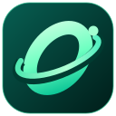

# OrbitDroid — Android Player for Mac

Developed by **Rahul Thakur**. Copyright © 2026 Rahul Thakur.

This public repository provides product information, support and release
binaries. The new proprietary application source and private key issuer are
not published here. This is not an open-source source-code repository.

## Download

Open this repository's **Releases** page and choose:

| Mac | File | Minimum macOS |
|---|---|---|
| Apple silicon (M-series) | OrbitDroid_Mac_Apple_Silicon.zip | 13 |
| Intel, 64-bit | OrbitDroid_Mac_Intel.zip | 13 |

At least 8 GB RAM, 20 GB free disk and hardware virtualization are required.
Additional images/devices need more space. Old macOS versions and 32-bit Macs
are not supported. Use the native build; the Intel build cannot run Android
through Rosetta on an Apple silicon Mac. Game compatibility varies.

Extract the complete ZIP and open Install_OrbitDroid.command. Android downloads
separately from Google after you review its agreements. These releases are
locally signed, not Apple-notarized Developer ID releases.

## Free and Pro

| Feature | Free | Pro |
|---|---|---|
| One Android 11 device, single APK installs, Google Play | Yes | Yes |
| App Center, graphics presets, Focus mode | Yes | Yes |
| Android 14 | Locked | Yes |
| Additional devices | Locked | Up to 8 total |
| Batch/split APK installs, file sharing, screenshot export | Locked | Yes |
| Private source code | Separate paid agreement | Separate paid agreement |

## Request your license key

Email **[rohan1ttg2001@gmail.com](mailto:rohan1ttg2001@gmail.com)** with the Device
ID shown in **License & upgrade**. Agree pricing/payment terms with Rahul, then
paste the key sent after payment confirmation and click Activate Pro. Keys are
issued for one Mac. Ask about paid source access through the same address.

The app has no automatic checkout. No source-access payment or Pro key grants
copyright ownership unless a separate written agreement says so.

## Ownership and components

See LICENSE for the new app terms. Prior OrbitDroid versions released under
MIT keep their existing permissions. Electron, Chromium, fast-xml-parser and
Google's tools/images retain their respective licenses and notices.
