

  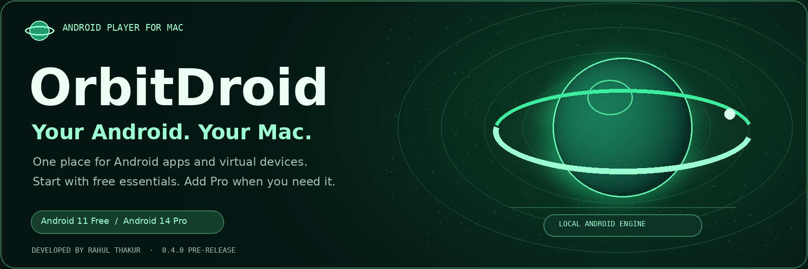

  <strong>One place for your Android apps and virtual devices.</strong> 
  Free essentials. Your own apps. A workspace on your Mac.

  
  
  
  
  

  <a href="#download">Download</a> ·
  <a href="#install">Install</a> ·
  <a href="#screenshots">Screenshots</a> ·
  <a href="#how-to-use">How to use</a> ·
  <a href="#smoother-settings">Smoother settings</a> ·
  <a href="#privacy-and-safety">Privacy &amp; safety</a> ·
  <a href="#comparison">Compare</a> ·
  <a href="#troubleshooting">Fix a problem</a> ·
  <a href="#contact">Contact</a>

OrbitDroid is a Mac dashboard for Google's Android Emulator. It brings device
setup, app installs, settings and session controls into one place. Android runs
locally in its own window. **Developed by Rahul Thakur.**

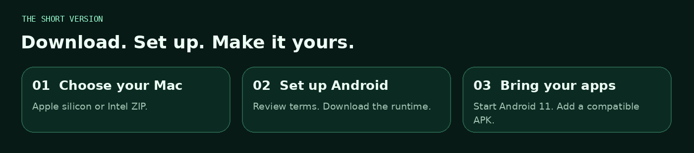

## Download

| Your Mac | Get OrbitDroid 0.4.0 | Android architecture |
|---|---|---|
| **Apple silicon — M-series** | [Download Apple silicon ZIP](../../releases/download/v0.4.0/OrbitDroid_Mac_Apple_Silicon.zip) | ARM64 |
| **Intel — 64-bit** | [Download Intel ZIP](../../releases/download/v0.4.0/OrbitDroid_Mac_Intel.zip) | x86_64 |

**Before you start:** macOS **13+**, at least **8 GB RAM**, hardware virtualization
and **20 GB free disk** for initial setup. Extra devices need more disk space.
Choose the native build for your chip. Older macOS and 32-bit Macs are unsupported.

Android's engine and system image download separately from Google during setup.
The Mac app ZIP is approximately 116 MiB for Apple silicon or 121 MiB for Intel.
[Check the SHA-256 hashes](SHA256SUMS.txt) before opening a trusted download.

> **Repository owner:** attach the two app ZIPs to the **v0.4.0 Release** for these
> buttons to work. This repository package contains the README, media and public
> guides. [Upload instructions](PUBLISH.md).

## Why OrbitDroid?

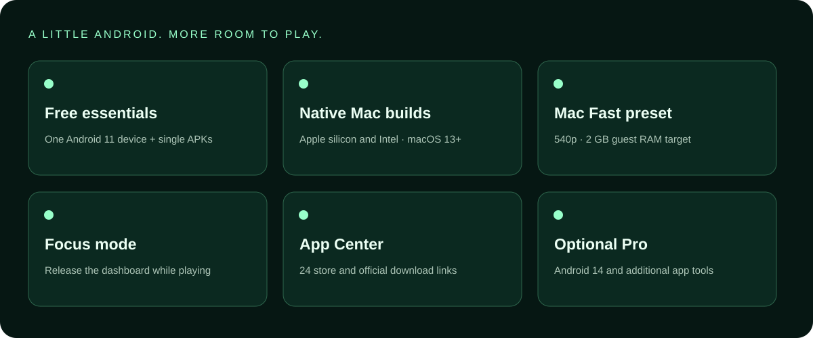

| What you want | What OrbitDroid gives you |
|---|---|
| A simple place to start | One Android 11 device and individual APK installs in Free |
| Room for your Mac | A smaller-screen Mac Fast preset and Focus mode |
| Your preferred apps | Google Play, compatible local APKs and 24 App Center links |
| Control over your session | Device settings, Android navigation, rotation and activity logs |
| More tools when needed | Optional Pro adds Android 14 and additional app tools |

These are workflow and configuration benefits. Game compatibility and speed
depend on the app, Mac, graphics and Android image; no FPS ranking is claimed.

## Install — follow the GIF

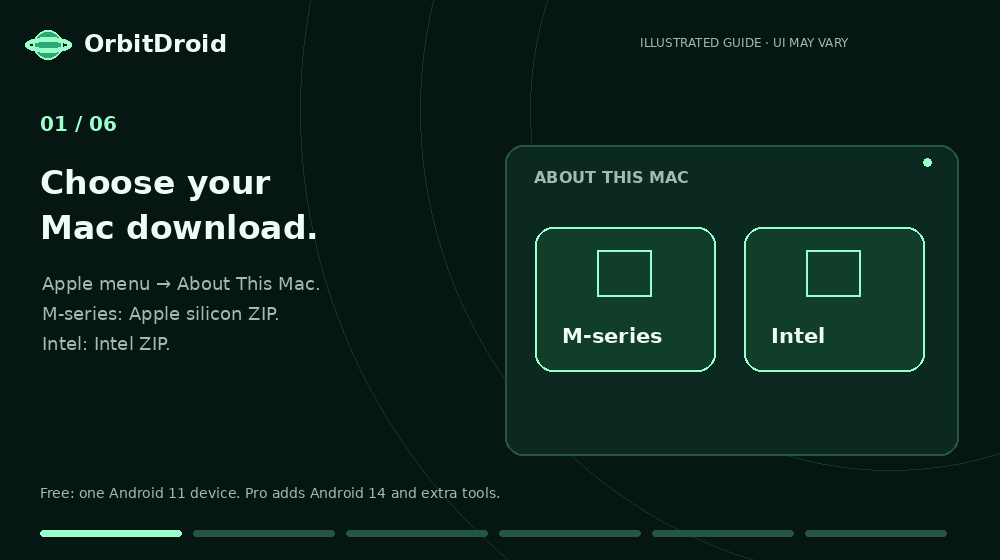

*Illustrated tutorial, not a screen recording. It shows the order of steps, not measured setup time.*

| Step | What to do |
|---|---|
| **1 · Choose your chip** | Apple menu → **About This Mac**. M-series → Apple silicon ZIP; Intel → Intel ZIP. |
| **2 · Extract the whole ZIP** | Keep `OrbitDroid.app`, `Install_OrbitDroid.command` and the support files together. |
| **3 · Install** | Stop Android, quit an older copy, then open **Install_OrbitDroid.command**. Choose Replace when updating. |
| **4 · Review the terms** | Open **Downloads → Android 11**. Read Google's SDK/image agreements before accepting. |
| **5 · Let setup finish** | Keep internet connected and disk space free. The engine and Android image download separately. |
| **6 · Start Android** | Create/select your Android 11 device, click **Start Android**, then install your own compatible apps. |

No Android Studio or Java installation is required for this launcher's setup.
[Full install guide](docs/INSTALL.md) · [Static tutorial image](assets/graphics/install-poster.png)

<strong>The installer script will not open</strong>

First read the safety section below and verify the download you intend to trust.
Extract every file. In Terminal, type `bash` and a space, drag that exact trusted
`Install_OrbitDroid.command` into the window, then press Return. Do not use an
unrelated script or disable system security globally.

[More installation help](docs/INSTALL.md)

## A look inside

### Emerald Aurora dashboard

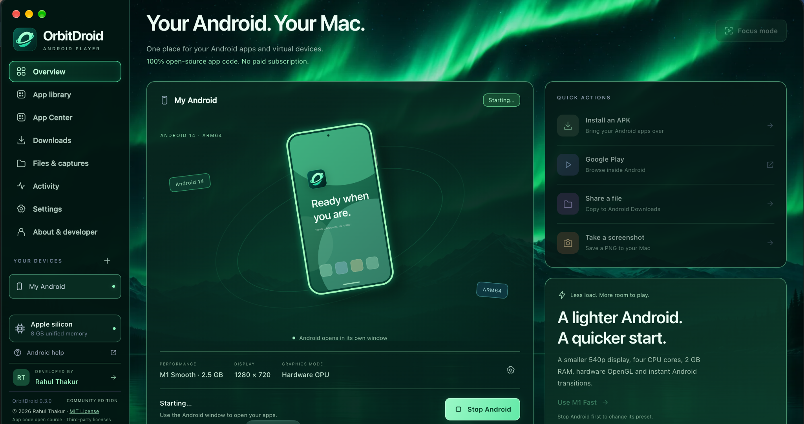

**Screenshot note:** these images were supplied from earlier builds. The 0.3
Community dashboard's open-source wording is historical. The current 0.4
[Free/Pro features](#free-and-pro) and [license](LICENSE) are described here.

### Android running on the Mac

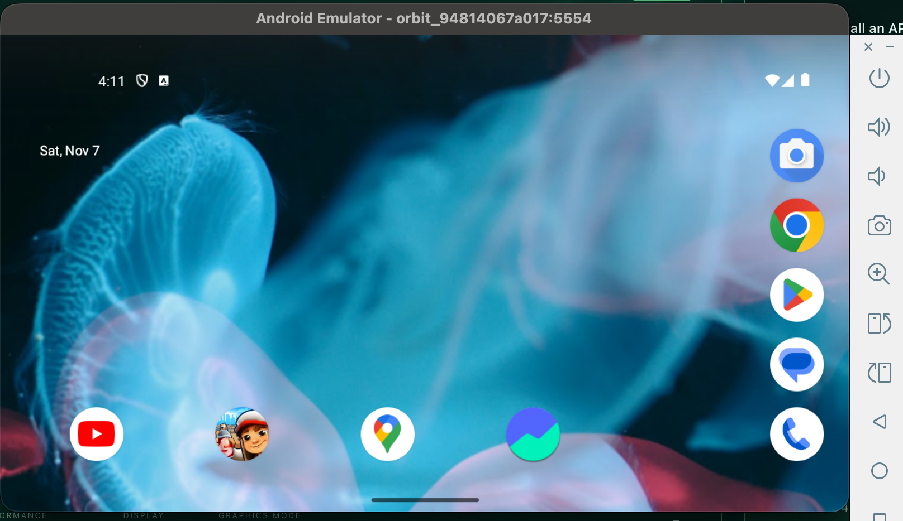

Apps visible in this screenshot were installed separately. They are not bundled
with OrbitDroid, and this image is not a benchmark of version 0.4.

<strong>Open the Extended Controls screenshot</strong>

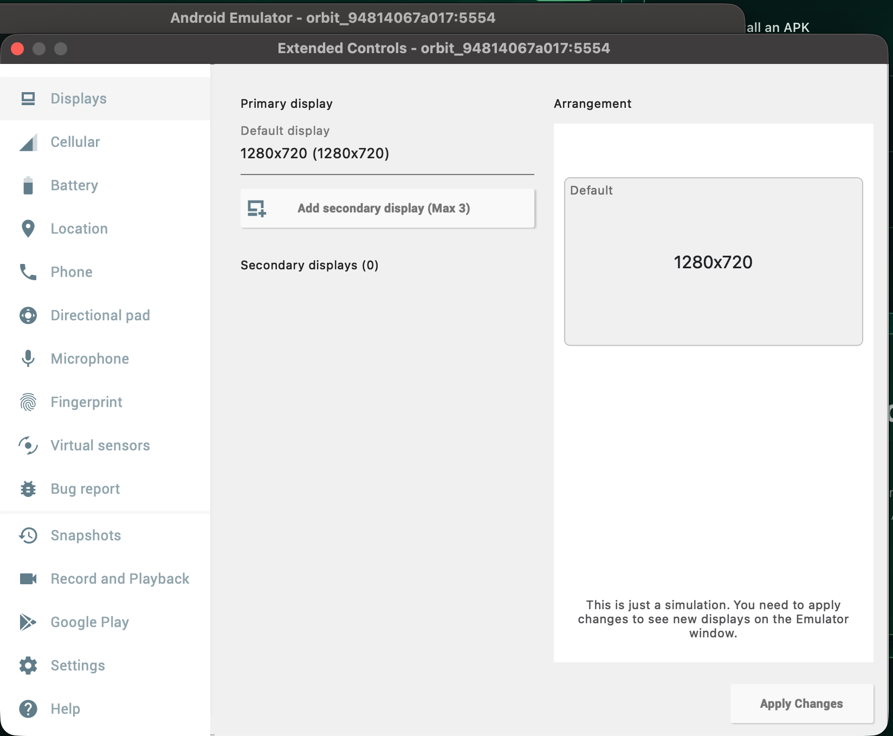

These are Google's separate emulator controls. They simulate device behavior;
availability depends on the engine/image and is not a promise of every Mac sensor.

<strong>See the neon emerald artwork</strong>

Decorative brand artwork. The actual supplied dashboard is shown above.

## How to use

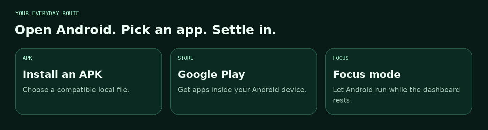

| Task | Steps |
|---|---|
| **Start your device** | Select it in the sidebar → **Start Android** → wait for Android to finish booting. |
| **Install one APK** | Start Android → **Install an APK** → choose a compatible local file. Drag/drop is also supported. |
| **Find apps** | Open **Google Play** inside Android, or choose an **App Center** shortcut. Store accounts and app purchases are separate. |
| **Open or remove an app** | Use **App library** to find installed third-party packages and open/uninstall them. |
| **Return to the dashboard** | If Focus mode closed it, click the OrbitDroid Dock icon. |
| **Change settings** | Stop Android first → change the device's settings → start again. |
| **Get extra tools** | Pro adds batch/split installs, dashboard file sharing and screenshot export. |

Only one Android device runs at a time. Apple silicon needs compatible ARM64 APKs;
Intel needs compatible x86_64 APKs, or use a suitable universal APK. Not every game
supports emulators, and versions/devices have separate data.

[Everyday guide](docs/HOW_TO_USE.md) · [APK troubleshooting](docs/TROUBLESHOOTING.md#an-apk-will-not-install)

## A smoother starting point

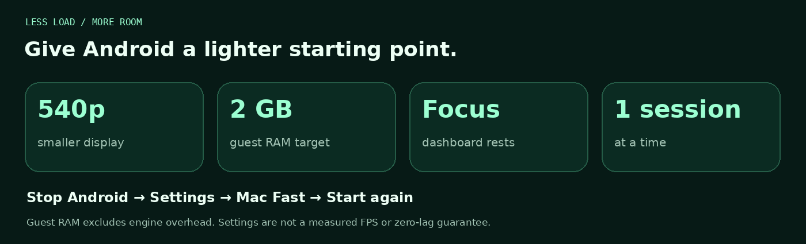

1. **Stop Android**, then choose **Settings → Mac Fast**.
2. Try the smaller **540p** display and the **2 GB guest RAM** target.
3. Enable **Focus/Auto Focus**, close heavy apps and avoid running another VM.
4. Reduce the game's own graphics settings. Try **Low load** if needed.
5. For unstable hardware graphics, try **Automatic** or **Software** rendering.

Software rendering can use more CPU. Guest RAM is only part of total host memory
use, and a 60 Hz setting is not a measured 60 FPS promise. Back up your device
before trying a reset; resetting is not the first fix for lag.

## Privacy and safety

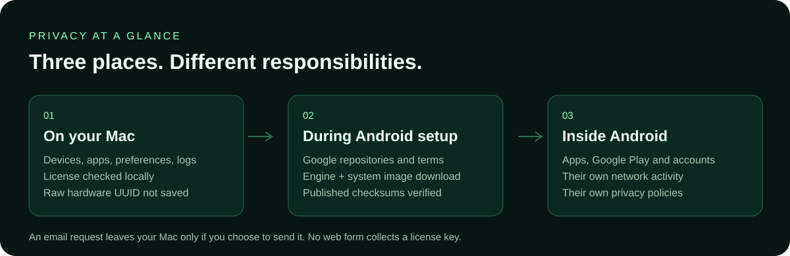

| Question | Clear answer for the reviewed 0.4 release |
|---|---|
| **Where are my devices and logs?** | On your Mac, in `~/Library/Application Support/OrbitDroid/`. |
| **Is there dashboard telemetry?** | No first-party telemetry upload was found in the reviewed 0.4 source. |
| **How are Pro keys checked?** | Locally. The key contains a customer email, hashed Device ID and license metadata. |
| **Is my raw Mac UUID sent?** | The dashboard reads it to derive a local hash; it does not save or send the raw UUID. The hash is still an identifier. |
| **Does clicking Email send anything?** | It drafts a message. It leaves only when you choose to send it. |
| **What about Google and Android apps?** | They have their own accounts, permissions, network activity and privacy policies. |
| **Is this independently certified malware-free?** | No. This build is ad-hoc signed and **not Apple-notarized**. |

Use the intended trusted release, compare its hash, read the installer and use
trusted APK sources. The runtime downloader checks Google's published archive
size/checksum metadata. A checksum match confirms integrity against a list;
it does not independently prove that an app is harmless.

### If macOS says “Apple could not verify…”

| The supplied alert | Annotated one-app settings example |
|---|---|
| 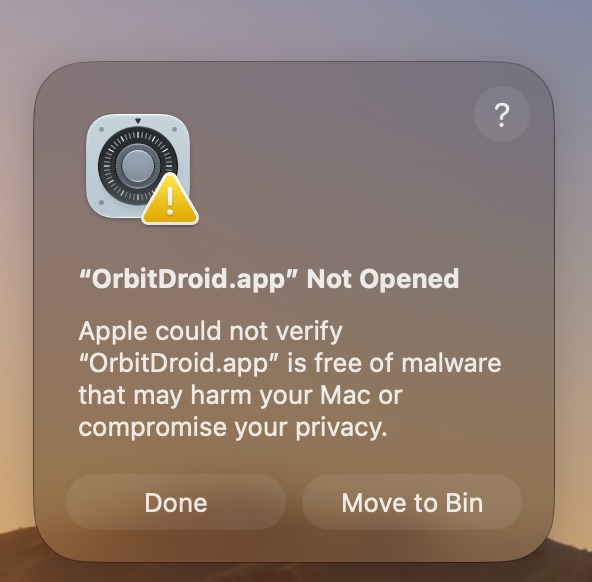 | 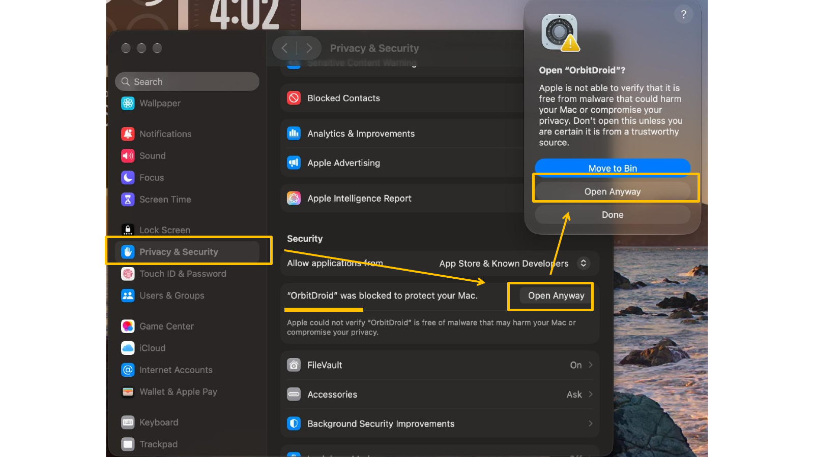 |

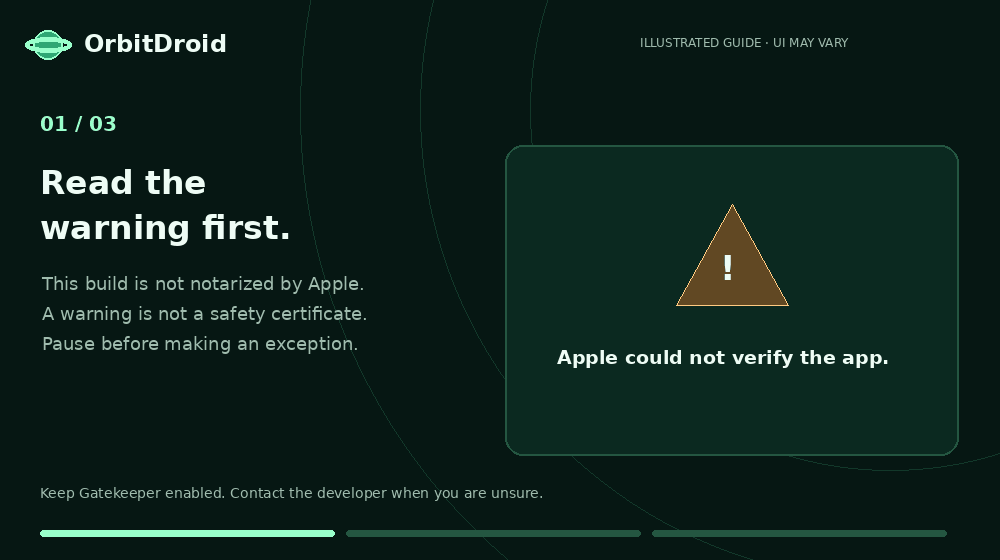

After checking and trusting that exact download, review Apple's documented
**System Settings → Privacy & Security → Open Anyway** option following a launch
attempt. Keep Gatekeeper enabled. If macOS reports known malware or unexpected
damage, stop and request help instead of forcing it open.

[Full privacy and safety notes](docs/PRIVACY_AND_SAFETY.md) · [Apple's explanation](https://support.apple.com/en-us/102445) · [Original annotated PDF](assets/guides/open-anyway.pdf)

## Free and Pro

**The Free tier costs ₹0 / $0 and has no trial timer for its included features.**
Pro pricing and duration are agreed with Rahul by email before purchase.

| Feature | Free essentials — ₹0 / $0 | Optional Pro |
|---|:---:|:---:|
| One Android 11 device | ✓ | ✓ |
| Single APK installs, Google Play and App Center | ✓ | ✓ |
| Mac Fast, graphics settings and Focus mode | ✓ | ✓ |
| Android 14 | — | ✓ |
| Additional devices — up to 8 total | — | ✓ |
| Batch and split APK installs | — | ✓ |
| Dashboard file sharing and screenshot export | — | ✓ |

Keys are checked on the Mac they were issued for. Payment confirmation and key
issuance are manual. Private source-code access is a **separate agreement**.
Existing device data is retained on upgrade or license expiry/removal; locked
features need an appropriate key. Different Android versions do not migrate data
automatically.

[Ask Rahul about Pro](mailto:rohan1ttg2001@gmail.com?subject=OrbitDroid%20Pro%20pricing%20request)

## Compare with MuMuPlayer for Mac

This selected comparison covers OrbitDroid and MuMuPlayer for Mac.

| Emulator | Free access | Paid access / price | Useful context |
|---|---|---|---|
| **OrbitDroid 0.4** | **₹0 / $0 Free essentials** | Pro: pricing by email | Apple silicon + Intel; Android 11 Free / 14 Pro; macOS 13+ |
| [MuMuPlayer for Mac](https://www.mumuplayer.com/help/mac/free-trial-and-membership.html) | Eligible **7-day trial** | Paid membership afterward; current amount shown at checkout | Trial is limited to eligible Macs; plans/regions vary |

*Checked 7 November 2026 using official vendor sources. Prices can change and may
exclude taxes. Other free options exist. This is a feature/price overview, not a
head-to-head speed or security ranking.*

[Comparison details and sources](docs/COMPARISON.md)

## Having a problem?

| Problem | First useful fix | More help |
|---|---|---|
| **macOS blocks opening** | Read the exact alert, verify your trusted release and check the one-app guidance. | [Opening help](docs/PRIVACY_AND_SAFETY.md) |
| **Lag or stutter** | Stop Android → Mac Fast or Low load; use Focus and lower in-game graphics. | [Speed settings](docs/TROUBLESHOOTING.md#android-feels-slow) |
| **Setup or boot stalls** | Check free disk, internet, Activity errors and the native Mac build. Try a cold restart. | [Boot help](docs/TROUBLESHOOTING.md#setup-or-boot-stalls) |
| **APK will not install** | Check architecture, Android version and whether all matching split APKs are present. | [Install errors](docs/TROUBLESHOOTING.md#an-apk-will-not-install) |
| **Google Play problem** | Check Android internet, account/terms steps, region and the exact store error. | [Store help](docs/TROUBLESHOOTING.md#google-play-or-network-issues) |
| **Pro key or feature locked** | Check the assigned Mac, complete key, accurate date/time and agreed expiry. | [License help](docs/TROUBLESHOOTING.md#license-or-pro-feature-is-locked) |

**Keep your existing devices and data.** Reset/Wipe deletes the selected Android
device's apps and data. Use it only after backing up and understanding the effect.

<strong>How do I uninstall OrbitDroid?</strong>

Stop Android and quit OrbitDroid. Remove the app from `~/Applications/` or its
manual installation location. Removing the app alone can leave your Android data
for a reinstall. Optional deletion of `~/Library/Application Support/OrbitDroid/`
permanently removes local devices, apps, accounts, settings, logs and the stored
key. Back up first. Do not delete an unrelated Android SDK.

[Complete uninstall guide](docs/TROUBLESHOOTING.md#how-to-uninstall)

<strong>Will every game work? Can every Mac run it?</strong>

No universal compatibility is promised. A game's architecture, Android version,
DRM, graphics and emulator/anti-cheat requirements can limit it. These Mac builds
require macOS 13+, a 64-bit Intel or Apple silicon chip and working virtualization.
Native Mac testing across all supported configurations has not been completed.

## Contact Rahul

[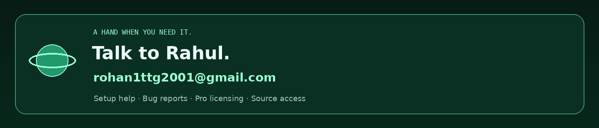](mailto:rohan1ttg2001@gmail.com)

**Email:** [rohan1ttg2001@gmail.com](mailto:rohan1ttg2001@gmail.com)

For installation help or a bug, include your **Mac chip, macOS version, OrbitDroid
version, Android version and the exact error**. For Pro or paid source access,
email Rahul privately. Do not post activation keys, Device IDs, passwords, account
details or private file paths in public issues.

Bug reports can also use this repository's **Issues → New issue → Bug report**
template after the owner enables Issues. No response-time guarantee is promised.

## Copyright, license and release notes

**Developed by Rahul Thakur · © 2026.** Current 0.4 original app terms are in
[LICENSE](LICENSE). Rights already granted in the earlier
[0.3 MIT release](licenses/OrbitDroid-0.3-MIT.txt) remain valid. Google, Electron
and downloaded apps retain their own licenses and notices.

Version 0.4 is marked **pre-release**. The project reports automated backend,
window and licensing tests and simulated UI checks; those are not an independent
security audit, a game benchmark or complete native Mac compatibility validation.
The screenshots above show earlier builds. No downloadable client is uncopyable.

This public repository contains the README, images, GIFs, public documentation
and repository support files. Private app source, signing secrets, the owner key
issuer and customer keys are excluded. GitHub's automatic source archive contains
this public repository, not the private app project.

  <a href="PUBLISH.md">Upload this package</a> ·
  <a href="docs/SOURCES.md">Sources</a> ·
  <a href="ASSET_CREDITS.md">Artwork credits</a> ·
  <a href="SECURITY.md">Report a concern</a>

