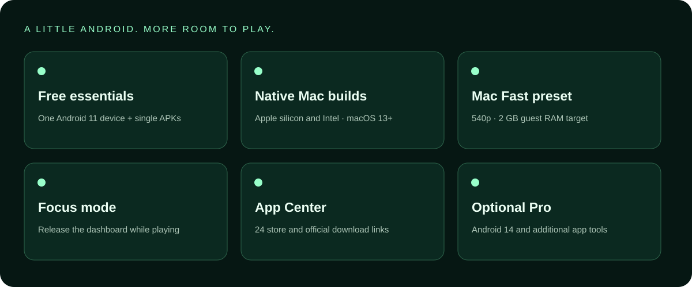

# Make yourself at home in OrbitDroid

## Open your Android session

Choose a device in the sidebar, then Start Android. Wait until Android finishes
booting before installing or opening an app. One device can run at a time.
Android opens in its own window. The dashboard's version label follows the actual
Android release reported by the guest after boot.

## Install an APK

1. Use an APK from a publisher or store you trust.
2. Start Android, choose Install an APK, and select a local file; drag/drop is also supported.
3. Free includes one APK at a time. Batch/split sets are Pro features.
4. Match architecture: ARM64/arm64-v8a for Apple silicon, x86_64 for Intel, or a compatible universal APK.

A split set is not a single ordinary APK. It needs all matching pieces from one
set, the Pro split installer and any requirements of that publisher. Apps may
also need game data, a newer Android version, DRM or store services.

## Google Play and App Center

Open Google Play inside Android. Account requirements, app purchases and app
availability are handled by that store. App Center provides 24 curated links to
store or official download destinations; it does not bundle those apps or make
paid apps free. Apps visible in the supplied screenshots were installed separately.

## Daily controls

- Use Android Back, Home and Recents, rotation and volume controls.
- App library lists third-party installed packages; open or uninstall them there.
- Google Android Emulator's Extended Controls simulate device features such as
  display arrangements. Availability depends on its image/engine and is not a
  promise that your Mac exposes every physical sensor.
- Pro adds OrbitDroid dashboard file sharing and screenshot export. That license
  does not remove rights in macOS capture tools or Google's separately licensed controls.

## A lighter session

Stop Android before editing its settings. Mac Fast uses a 540p screen, 2 GB guest
RAM target, up to four CPU threads, hardware OpenGL and animations off. Low load
reduces the display refresh target and core count. Guest RAM is not the whole
engine's host memory footprint. Refresh settings are not measured game FPS.

Focus mode closes the dashboard renderer while Android runs. Click the Dock icon
to return. Auto Focus can do this after startup. If graphics is unstable, try
Automatic or Software; software rendering can cost more CPU.

## Free and Pro

Free: one Android 11 device, individual APK installs, stores/App Center and
performance/Focus settings. Pro: Android 14, additional devices up to eight total,
batch/split APKs, dashboard file sharing and screenshot export.

For a key, open License & upgrade and email Rahul with your Device ID. Pricing,
payment and duration are agreed first; the owner issues a signed key after
confirming payment. The key works on its assigned Mac. No automatic web checkout
or central activation service is included. Source-code access is a separate agreement.

## Keep your data

Android versions and devices have separate apps/accounts. No automatic cross-version
migration is provided. Before a Reset/Wipe, back up anything important: it erases
that device's data. Expired/removed keys retain device data; paid features lock.

[Troubleshooting](TROUBLESHOOTING.md) · [Privacy](PRIVACY_AND_SAFETY.md)
