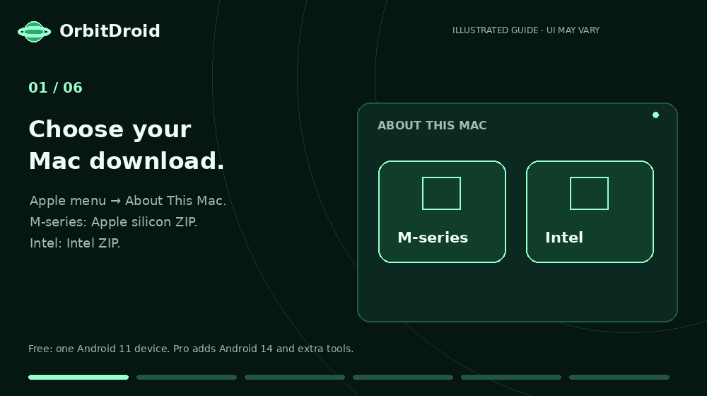

# Install OrbitDroid on your Mac

This animation is an illustration of the workflow, not a native screen recording.

## Before you start

- macOS 13 or newer, a 64-bit Intel or Apple silicon Mac and hardware virtualization.
- At least 8 GB RAM and 20 GB free for initial Android setup; more devices need more.
- A trusted project release, the correct native ZIP and a stable internet connection.
- Close Android and quit an older OrbitDroid before updating. Updates keep device data.

## Six steps

1. **Choose your chip.** Apple menu → About This Mac. M-series → Apple silicon ZIP.
   Intel processor → Intel ZIP. Do not run Intel Android through Rosetta on an M-series Mac.
2. **Extract the complete ZIP.** Keep the app, Install_OrbitDroid.command and its support
   files in the same extracted folder. Do not move only the installer elsewhere.
3. **Install.** Open Install_OrbitDroid.command. If your Mac blocks that script, open
   Terminal, type `bash` and a space, drag that exact trusted script in, then Return.
   Choose Replace if updating. The app goes into your user Applications folder.
4. **Read Google's terms.** Open Downloads → Android 11 for the Free setup. Review the
   SDK and image agreements, and accept only if you agree. No Android Studio/Java is needed.
5. **Let Android download.** The engine and image come separately from Google. Their
   current sizes, progress and checksum verification are handled in the app. Keep space free.
6. **Start your device.** Create/select Android 11, then Start Android. First boot can
   take time. Add your own apps via a compatible APK, Google Play or an App Center link.

## Check the ZIP

Use the project's [SHA-256 list](../SHA256SUMS.txt). In Terminal, type
`shasum -a 256 `, drag the ZIP after the space, and press Return. Compare the
entire result with the entry for that filename. These hashes apply to release 0.4.0.
A matching hash establishes integrity against that list, not independent malware safety.

## macOS warning

This is an ad-hoc signed release, not an Apple-notarized Developer ID app.
Read [Privacy and safety](PRIVACY_AND_SAFETY.md) before opening. If you trust the
specific download, Apple's documented app-specific option is in System Settings →
Privacy & Security after an attempted launch. Do not disable Gatekeeper globally.
For known malware or unexplained damage, stop and contact the developer instead.

[Annotated macOS example](../assets/guides/open-anyway.png) · [Original supplied PDF](../assets/guides/open-anyway.pdf)

## Existing devices

Android 11 and 14 use separate data. Updating keeps older devices; Free can start the
first Android 11 device, while Android 14 and additional devices need Pro. A key request
is made in License & upgrade. Do not reset an existing device just to install an update.

Need help? Email **rohan1ttg2001@gmail.com** with the exact error, app version, Android
version, Mac chip and macOS version. Do not include a private activation key.
