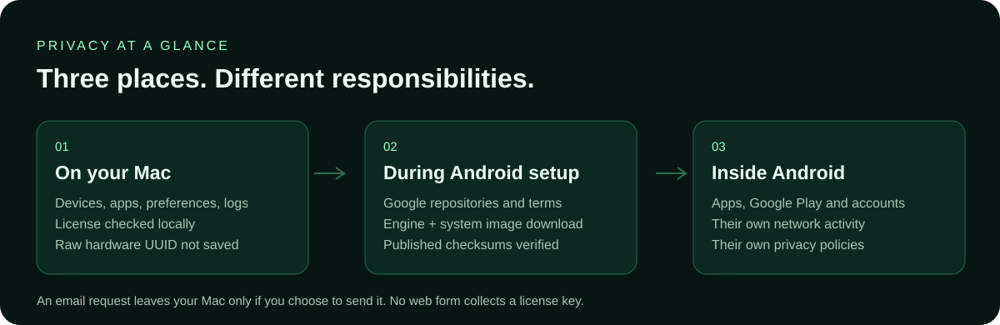
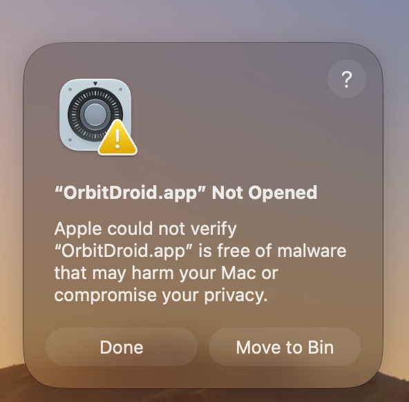
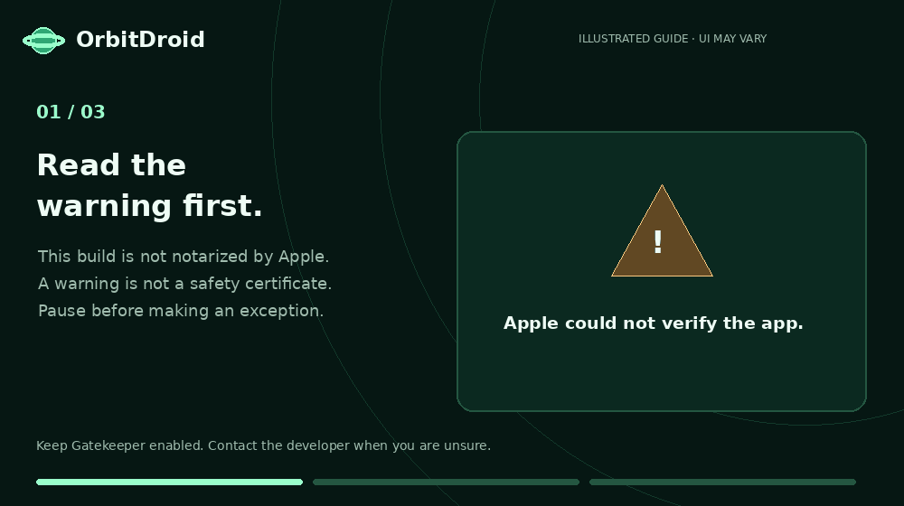

# Privacy and safety: clear boundaries

These notes describe the reviewed OrbitDroid **0.4.0** source, not every future
version or every app that can run inside Android. They are product information,
not an independent security audit or a promise of malware-free software.

## What stays local

- Devices, preferences, download cache and logs are under
  `~/Library/Application Support/OrbitDroid/` on your Mac.
- The dashboard validates signed license keys locally. A stored key contains
  its customer email, hashed Device ID, license metadata and any expiry.
- At startup, the app reads IOPlatformUUID and derives a hashed Device ID.
  The dashboard does not save or send the raw UUID.
- The reviewed 0.4 source has no first-party telemetry upload or activated ad
  network. Its dashboard renderer uses sandboxing and context isolation.

The hash is still an identifier. An app request email contains it if you choose
to send that message. Email buttons draft a message in your mail app; nothing
is sent automatically. Never post your license key or Device ID in a public issue.
Offline validation does not provide remote revocation or a trusted central clock.

## What uses the network

Setup checks Google's official HTTPS Android repositories, downloads tools/images,
and verifies the archives against published size/checksum metadata. Google's
agreements are displayed before setup. Google Play and other apps may contact
their own services, use accounts and collect data according to their policies.
Running Android locally does not make every app offline or anonymous.

This public repository contains Markdown, images and GIFs; its README does not
embed a tracking script, license collection form or payment form. GitHub hosts
the repository and applies its own privacy policy. External links and email
providers have their own privacy policies. No README code reads your Mac UUID.

## About the warning in your screenshot

OrbitDroid 0.4 is locally ad-hoc signed, **not Apple-notarized**. Apple cannot
supply its normal Developer ID/notarization assurance for this release. A warning
is not a clean bill of health. A checksum match alone is not a malware scan.

If you are confident in the source and the exact download, Apple's help describes
a one-app exception after a launch attempt, through Privacy & Security in System
Settings. Review the prompt and decide for yourself. Keep Gatekeeper enabled.
If the alert identifies malware or unexpected damage, do not force the app open:
get help, check integrity and obtain a trusted replacement.

[Your annotated settings example](../assets/guides/open-anyway.png) · [Original PDF](../assets/guides/open-anyway.pdf)

## Practical safety habits

Use your intended project release and the [published 0.4 hashes](../SHA256SUMS.txt).
Read the installer and agreements. Install APKs only from sources you trust and
review Android permissions. Keep macOS and apps updated. Back up before wiping
a device. Do not run a global Gatekeeper/SIP-disable command for this app.

The project reports 66 automated backend/window/licensing tests and simulated
interface checks. These do not certify security, game compatibility, Intel/Mac
boot behavior or a particular FPS. The supplied screenshots show earlier builds.

Support: **rohan1ttg2001@gmail.com**. Redact keys, account information and private
file paths before sharing logs. For full app-data deletion, read the uninstall
section in [Troubleshooting](TROUBLESHOOTING.md).

Official references: [Apple's app-opening guide](https://support.apple.com/en-us/102445),
[Google's emulator acceleration guide](https://developer.android.com/studio/run/emulator-acceleration),
and [GitHub's privacy statement](https://docs.github.com/en/site-policy/privacy-policies/github-general-privacy-statement).
